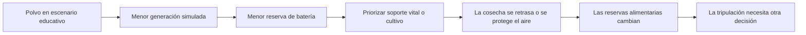

# MARS OUTPOST: HORIZONTE ROJO

> **«Cada decisión cuesta. Cada sol cuenta.»**
>
> Especificación maestra conceptual, funcional, científica y técnica  
> NASA Space Apps Challenge 2026 · Versión documental 1.0 · 14 de noviembre de 2026

## Estado y alcance de este documento

Este archivo define el producto futuro. **Es una especificación, no evidencia de implementación.** Las pantallas, endpoints, cifras de juego, integraciones y arquitectura descritos aquí son requisitos o propuestas hasta que el equipo los construya, los pruebe y registre evidencia.

El espacio de trabajo inspeccionado actualmente se llama `LUNAR COMMAND` y ya contiene las carpetas `frontend/` y `backend/` con un prototipo lunar anterior. Esta documentación **no elimina ni reemplaza ese código**: borrar de forma masiva el proyecto y sus dependencias supondría una operación destructiva. Antes de migrar o retirar el prototipo lunar, el equipo debe acordar y ejecutar por separado una migración revisable que preserve los cambios útiles y el historial de Git. La arquitectura futura aquí descrita mantiene `frontend/` y `backend/` como las únicas carpetas principales del proyecto.

## Tabla de contenidos

1. [Identidad y descripción](#1-identidad-y-descripción-del-proyecto)
2. [Desafío y propósito educativo](#2-descripción-del-desafío-de-nasa)
3. [Narrativa de la misión](#3-concepto-narrativo)
4. [Bucle de juego](#4-mecánica-general-del-videojuego)
5. [Modelo de recursos](#5-sistema-de-recursos)
6. [Módulos del equipo](#6-los-cinco-módulos)
7. [Motor central](#7-sistema-central-de-simulación)
8. [Fuentes científicas](#8-datos-y-recursos-científicos)
9. [Integración y trazabilidad de datos](#9-integración-de-datos)
10. [Criterios de evaluación NASA](#10-criterios-de-evaluación-y-evidencias)
11. [Diseño y accesibilidad](#11-diseño-y-experiencia-de-usuario)
12. [Arquitectura tecnológica](#12-arquitectura-tecnológica-propuesta)
13. [Estructura futura](#13-estructura-futura-del-proyecto)
14. [Contratos de API propuestos](#14-api-y-comunicación)
15. [Organización del equipo](#15-organización-del-equipo)
16. [Seguridad, privacidad y accesibilidad](#16-seguridad-privacidad-y-accesibilidad)
17. [Plan de desarrollo](#17-plan-de-desarrollo)
18. [Glosario](#18-glosario)
19. [Referencias](#19-referencias)

---

## 1. Identidad y descripción del proyecto

| Atributo | Definición |
|---|---|
| Nombre | **MARS OUTPOST** |
| Subtítulo | **HORIZONTE ROJO** |
| Evento | NASA Space Apps Challenge 2026 |
| Tipo | Videojuego educativo web de supervivencia y gestión de recursos espaciales |
| Público principal | Niños y niñas de 7 a 12 años |
| Plataforma | Navegador web, adaptable a móvil, tableta y computadora |
| Escenario | Puesto científico humano hipotético en el cráter Jezero, Marte |
| Duración | Siete turnos principales; cada turno representa un sol |
| Modalidad | Simulación por turnos, decisiones y consecuencias acumulativas |
| Equipo | Cinco integrantes, uno por módulo |

### 1.1 Descripción ejecutiva

MARS OUTPOST es una experiencia interactiva en la que el jugador dirige una estación científica **imaginaria** en Jezero. Durante siete soles, debe mantener a salvo a una pequeña tripulación, administrar recursos compartidos y tomar decisiones científicas mientras ocurren problemas ambientales, fallas técnicas y retrasos de comunicación.

Cada turno presenta un informe de NOVA, el asistente de misión; condiciones y sucesos; reservas actuales; y decisiones con un costo visible. El jugador puede atender el invernadero, priorizar energía, recuperar agua, usar un refugio, explorar el delta o consultar a la Tierra. La acción elegida puede ayudar a un sistema y limitar otro. Al final recibe un informe que valora la supervivencia, la ciencia realizada y los aprendizajes, no solo una victoria o derrota.

### 1.2 Idea principal

La idea central es **enseñar sistemas interdependientes mediante decisiones comprensibles**: la energía sostiene el hábitat, el invernadero y la filtración; el agua y los alimentos sostienen a la tripulación; la protección puede reducir el tiempo de exploración; y la distancia a la Tierra impide delegar cada decisión.

### 1.3 Problema educativo

Los conceptos de ingeniería y ciencias espaciales suelen presentarse como datos aislados. Así es difícil ver por qué una solución técnica tiene límites, qué evidencia respalda una decisión o qué pasa cuando varios sistemas dependen del mismo recurso. El juego busca convertir esos conceptos en elecciones contextualizadas y explicar sus consecuencias en lenguaje sencillo.

### 1.4 Justificación y valor

- Convierte conceptos científicos en acciones, retroalimentación y reflexión.
- Distingue evidencia de NASA, hipótesis narrativa y simplificación de juego.
- Hace visible el costo de oportunidad: no se puede priorizar todo a la vez.
- Permite aprender mediante prueba, observación y repetición, sin registro obligatorio.
- Ofrece a los jueces evidencia presentable de ciencia, datos, tecnología, misión, narrativa y arte, siempre que los criterios implementados tengan pruebas verificables.

### 1.5 Objetivos

**Objetivo general:** diseñar una misión educativa breve que permita explorar cómo una tripulación hipotética puede gestionar recursos y objetivos científicos en Marte.

**Objetivos específicos:**

1. Explicar la relación entre energía, soporte vital, alimentos y protección.
2. Presentar Jezero y sus evidencias geológicas con referencias científicas consultables.
3. Representar decisiones con costos, beneficios y consecuencias comprensibles.
4. Enseñar que las comunicaciones Tierra-Marte tienen retraso.
5. Ayudar al jugador a distinguir datos históricos, eventos de API y valores simulados.
6. Facilitar la colaboración de cinco integrantes mediante límites de módulo y contratos compartidos.

### 1.6 Características diferenciadoras

- Una misión de siete soles con estado persistente y consecuencias acumulativas.
- NOVA explica por qué ocurre un resultado, no solo muestra un número.
- Fichas de procedencia visibles para las fuentes científicas.
- Variables internas separadas aunque la interfaz resuma sistemas en indicadores fáciles de leer.
- Escenario 3D funcional subordinado a la claridad, el rendimiento y la comprensión.
- Un informe final que recompensa el aprendizaje y la justificación, incluso si la colonia no completa todos sus objetivos.

## 2. Descripción del desafío de NASA

La propuesta responde al reto de crear una experiencia interactiva en la que niños de 7 a 12 años administren un puesto avanzado lunar o marciano, tomen decisiones de supervivencia y observen sus consecuencias durante una misión simulada. **La decisión de producto especificada aquí es Marte y Jezero**, no un puesto lunar.

### 2.1 Temas que enseña

| Tema | Representación en el juego | Pregunta educativa |
|---|---|---|
| Soporte vital | Agua, oxígeno y CO₂ se calculan por separado | ¿Qué necesita el aire de un hábitat cerrado? |
| Blindaje y seguridad | Refugio, estado de protección y decisión de salir | ¿Cuándo conviene reducir la exposición y cuándo explorar? |
| Presupuesto energético | Generación, reserva y prioridades | ¿Qué sistemas reciben energía si no alcanza para todos? |
| Producción de alimentos | Cultivo con costo inmediato y cosecha diferida | ¿Por qué una cosecha no resuelve el hambre de hoy? |
| Comunicación | Consulta pendiente que llega en un turno posterior | ¿Por qué una tripulación no puede conversar en tiempo real con la Tierra? |
| Recursos limitados | Consumo diario, recuperación parcial y reservas | ¿Cómo cambia una decisión futura cuando gasto ahora? |
| Autonomía | El comandante decide con información disponible | ¿Qué datos hacen falta cuando no podemos esperar? |
| Ingeniería de sistemas | Acciones de un módulo afectan recursos compartidos | ¿Qué solución ayuda a un sistema pero perjudica a otro? |

El propósito no es convertir la interfaz en una enciclopedia con botones espaciales. La ciencia debe determinar qué opciones existen, qué variables cambian y qué explicaciones acompañan el resultado.

## 3. Concepto narrativo

### 3.1 Contexto inicial

En un futuro cercano ficticio, una expedición internacional instala un puesto experimental en las cercanías del antiguo delta de Jezero. No es una misión real de NASA ni una afirmación de que existan humanos en Marte. Los sistemas de la estación son un escenario educativo que toma inspiración de investigación real, pero sus capacidades y recursos se simplifican.

El jugador toma el mando al comienzo de una ventana operativa de siete soles. El equipo debe estabilizar el puesto, reunir observaciones geológicas y dejar recomendaciones útiles para una futura expedición.

### 3.2 Presentación de la misión

**Misión Horizonte Rojo**

- **Ubicación:** zona de trabajo hipotética en Jezero, inspirada en el contexto geológico documentado por el rover Perseverance.
- **Duración:** siete turnos, uno por sol.
- **Objetivo de supervivencia:** mantener a la tripulación con salud y reservas esenciales por encima de cero.
- **Objetivo científico:** analizar el entorno del antiguo delta y registrar lo que las observaciones permiten y no permiten concluir.
- **Objetivo operativo:** llegar al final con una combinación razonada de energía, agua, oxígeno, alimentos y protección.
- **Restricción central:** solo se permiten un número limitado de acciones importantes por turno; la Tierra no ofrece respuesta instantánea.

### 3.3 Tripulación

Los personajes son ficticios y se deben introducir como roles, no como profesionales reales ni como personas NASA:

| Rol narrativo | Aporte | Necesidad que el juego puede enseñar |
|---|---|---|
| Comandante, jugador | Coordina prioridades y acepta riesgos | Responsabilidad y toma de decisiones |
| Geóloga/o de campo | Sugiere observaciones del delta | Geología, muestras y límites de evidencia |
| Ingeniera/o de sistemas | Revisa energía y equipos | Mantenimiento e interdependencia |
| Especialista en soporte vital | Vigila aire y agua | Reciclaje y control ambiental |

La tripulación se presenta como un equipo diverso. No se asignan efectos científicos a género, nacionalidad o características personales. El estado de salud es una variable de juego, no un diagnóstico médico.

### 3.4 Evolución por soles

| Sol | Hito narrativo | Tensión o aprendizaje |
|---:|---|---|
| 1 | Llegada y revisión del puesto | Jezero y el delta antiguo; entender el estado inicial |
| 2 | Polvo sobre los paneles | La generación modelada baja y obliga a priorizar |
| 3 | El invernadero requiere atención | El crecimiento necesita recursos y tiempo |
| 4 | Válvula de reciclaje atascada | Recuperar agua requiere energía y mantenimiento |
| 5 | Oportunidad de analizar una roca del delta | Investigar implica energía y riesgo de salir |
| 6 | Aviso educativo de meteorología espacial | Revisar el refugio sin confundir alerta solar con dosis marciana |
| 7 | Informe final y último enlace | Cerrar la misión con los recursos y aprendizajes alcanzados |

Los sucesos pueden variar entre partidas, pero cada partida debe explicar qué reglas y fuentes justifican el evento. Una selección aleatoria de escenario no debe fabricar ni alterar una observación presentada como dato NASA.

### 3.5 NOVA

NOVA es un asistente ficticio de software, no una IA autónoma ni una persona real. Utiliza mensajes definidos por el equipo, escogidos según el sol, el evento, los recursos y la decisión reciente. Debe:

- presentar un informe diario;
- traducir términos con vocabulario adecuado a 7–12 años;
- advertir de recursos bajos antes de una acción peligrosa;
- explicar consecuencias causales después de cada decisión;
- incluir un enlace o ficha de fuente cuando mencione evidencia;
- declarar cuando un valor es inventado para la simulación.

**Ejemplo:** «El polvo hace que llegue menos energía a los paneles en nuestro modelo. MEDA estudia el ambiente marciano, pero este número es una regla del juego, no una lectura de electricidad de MEDA».

### 3.6 Relación con la Tierra y desenlace

El jugador puede enviar una consulta a Tierra. La interfaz muestra el tiempo físico aproximado de propagación por trayecto (alrededor de 4–24 minutos, dependiente de la geometría planetaria) y, por separado, el retraso simplificado de la partida por turnos. Una respuesta predefinida no debe presentarse como comunicación real con NASA.

El desenlace contiene el estado de la tripulación, los recursos finales, decisiones importantes, objetivos científicos, conceptos aprendidos y recomendaciones. La supervivencia puede ser parcial; el informe debe explicar lo ocurrido sin castigar ni avergonzar al niño.

## 4. Mecánica general del videojuego

### 4.1 Bucle de juego

1. NOVA anuncia el informe del nuevo sol y el acontecimiento.
2. Se muestran recursos, estado de la tripulación, datos y alertas.
3. El jugador abre uno o más módulos y compara costos y beneficios.
4. Confirma acciones; el motor central valida recursos y límites de turno.
5. El juego aplica cambios y muestra una explicación accesible.
6. El jugador avanza el turno; se calculan consumos diarios, producción y consecuencias ambientales.
7. La misión registra historia, decisiones, respuestas pendientes y aprendizajes.
8. En el séptimo sol se genera el informe final.

### 4.2 Turnos y acciones

Como punto de partida para el balance, un sol permite **dos acciones principales** entre los cinco módulos y una acción final de avance. Cambiar de pantalla o consultar la ayuda no consume acción. Los costos definitivos se deben probar con niños y documentar como **unidades de juego**.

Cada opción informa antes de confirmarse:

- costo en recursos;
- beneficio esperado;
- riesgo o limitación;
- sistema afectado;
- si el resultado es inmediato o diferido;
- explicación científica y procedencia aplicable.

La operación completa se valida de forma atómica en el servidor. Si una acción falla, ningún recurso debe quedar parcialmente descontado.

### 4.3 Eventos y rejugabilidad

Cada campaña debe incluir, como mínimo, seis familias de evento: tormenta/polvo, aviso de meteorología espacial, problema del invernadero, falla del reciclador, oportunidad de exploración y retraso de comunicaciones. Se añade la llegada inicial como hito narrativo.

Una semilla de partida puede seleccionar una variante narrativa o el orden de eventos opcionales. Los siete hitos pedagógicos esenciales siguen accesibles. Cada evento registra tipo de escenario, regla aplicada, procedencia científica y su condición de dato real, histórico o simulado.

### 4.4 Emergencias y cierre

Cuando agua, oxígeno o alimentos llegan a cero, o cuando la salud se aproxima a un umbral crítico, NOVA debe avisar antes de permitir que el turno avance. Si no queda alternativa, el sistema aplica el estado de emergencia definido y lo explica. El juego no oculta saldos negativos ni transforma un fallo en un éxito silencioso.

El puntaje es una medida de progreso del juego, no una calificación escolar. Debe ponderar supervivencia, ciencia realizada, gestión razonada y conceptos aprendidos. Un jugador puede recibir un informe útil aunque no complete la misión.

### 4.5 Jornada ilustrativa

**Sol 2, polvo sobre paneles**

1. NOVA indica que la eficiencia de los paneles de la simulación bajó y recuerda que la variación es un modelo educativo.
2. El panel muestra energía en unidades de juego, agua, oxígeno, CO₂, comida, protección y condición de tripulación.
3. La persona puede dedicar una acción a limpiar los paneles (gasta energía y aumenta la generación modelada) o activar ahorro (reduce el consumo, pero retrasa el invernadero).
4. También puede usar otra acción para reciclar agua o atender otro sistema.
5. El jugador compara efectos y confirma.
6. El motor calcula la acción y registra el costo, el resultado y la explicación.
7. Al avanzar, se descuentan consumos diarios, se aplica el evento de polvo y se actualizan las comunicaciones.
8. NOVA explica qué cambió y por qué; el jugador puede revisar la fuente MEDA y la distinción entre ambiente y electricidad.

**Todas las cantidades del ejemplo son ilustrativas.** No describen mediciones de una colonia real.

## 5. Sistema de recursos

### 5.1 Indicadores resumidos de interfaz

| Indicador | Qué resume | Qué no debe ocultar |
|---|---|---|
| Energía | Generación y reserva disponible | Producción y consumo, fuente simulada o medida |
| Soporte vital | Lectura sencilla del aire y agua seguros | Agua, O₂ y CO₂ siguen separados internamente |
| Protección | Estado del refugio y preparación frente a riesgo | No equivale a dosis ni a evaluación médica |
| Alimentos | Reserva y cosechas pendientes | Tiempo de crecimiento y costo del cultivo |
| Tripulación | Salud/estado narrativo de equipo | No es un diagnóstico clínico |

### 5.2 Variables internas

| Variable | Unidad propuesta | Consumo, producción o dependencia | Condición de atención |
|---|---|---|---|
| Energía disponible | Unidades de juego (UJ) | La generan paneles modelados; la consumen los módulos y el uso diario | Reservas bajas limitan acciones y pueden afectar el hábitat |
| Generación solar | UJ por sol | Regla educativa influida por un escenario ambiental | No se deriva directamente de una lectura MEDA |
| Energía almacenada | UJ | Reserva finita; se usa cuando generación < demanda | Puede llegar a cero y activar emergencia energética |
| Agua | Unidades de juego (UJ) | Consumo de tripulación y cultivos; reciclaje parcial consume energía | Unidades en cero activan emergencia |
| Oxígeno | Unidades de juego (UJ) | Consumo del hábitat; reposición hipotética si se define en una fase futura | Debe mantenerse separado del agua y CO₂ |
| Dióxido de carbono (CO₂) | Índice interno de juego (IG) | Aumenta con la ocupación; filtración consume energía | Un IG crítico requiere revisar filtros; no representa ppm reales |
| Alimentos | Raciones o UJ etiquetadas | Consumo por sol; los cultivos producen tras varios turnos | Reservas bajas limitan supervivencia |
| Protección | Índice interno de juego (IG) | Mejora con refugio/acciones; disminuye al salir o en ciertos eventos | No es dosis absorbida, dosis equivalente ni un nivel médico |
| Salud de tripulación | Puntos de estado de juego (PEG) | Depende de condiciones de supervivencia definidas | Narrativa no clínica; muestra consecuencias sin alarmismo |
| Estado de instalaciones | Estado cualitativo o porcentaje de juego | Mantenimiento, eventos y uso | No implica confiabilidad certificada de hardware |
| Cultivo | Soles restantes/estado | Agua, energía, mantenimiento y duración de ciclo | La cosecha no es instantánea ni gratuita |

**Unidades científicas** (°C, Pa, m/s, Gy, Sv, etc.) se reservan para la ficha de una observación que efectivamente las mida y conserve misión, instrumento, fecha, unidad y enlace. No se convierten silenciosamente en unidades de juego.

### 5.3 Balance, límites y costos

El estado inicial y los coeficientes diarios son valores de balance propuestos. Deben centralizarse en el motor y ajustarse mediante pruebas de partidas. Cada costo se comprueba antes de descontar; una acción no autorizada, repetida o imposible no modifica el estado. Un sistema puede usar recuperación parcial, nunca recursos ilimitados implícitos.

La cadena típica es:



La condición inicial «polvo» puede inspirarse en fenómenos marcianos observados, pero no es un dato actual de producción fotovoltaica.

## 6. Los cinco módulos

Los cinco módulos son divisiones de trabajo y experiencias navegables. **No poseen cinco copias del inventario**: todas las acciones pasan por el estado de misión compartido y el motor valida costos, acciones disponibles y consecuencias.

### 6.1 AGRODOME · Integrante 1

**Especialización:** agricultura y producción de alimentos.

**Propósito:** enseñar que producir alimento en un hábitat requiere agua, energía, control ambiental, mantenimiento y tiempo.

**Funciones de producto previstas:**

- visualizar un invernadero 3D/2D legible;
- mostrar cultivos, fase y soles restantes;
- consultar reservas y cosechas pendientes;
- iniciar cultivo hidropónico o aeropónico solo si los recursos alcanzan;
- mostrar costo de agua y energía antes de confirmar;
- permitir cuidado/mantenimiento con beneficio diferido;
- comunicar temperatura y humedad solo como variables simuladas si no hay una observación trazable.

**Mecánicas propuestas:** iniciar un cultivo consume recursos ahora y genera alimentos después de varios soles. Un fallo o problema puede extender el ciclo. El rendimiento es un parámetro de juego, no un resultado de Veggie ni una afirmación sobre agricultura en Marte.

**Conexiones:** compite por energía con Power Core y Life Support; depende del agua del sistema común; la cosecha cambia las reservas de alimentos que usa Mission Control para evaluar la supervivencia.

**Fuentes:** NASA Veggie, NASA OSDR y CSA. Los experimentos de plantas en microgravedad se describen como investigación espacial, no como cultivo en superficie marciana.

### 6.2 POWER CORE · Integrante 2

**Especialización:** generación, almacenamiento y distribución de energía.

**Funciones previstas:**

- ver generación simulada, reserva y consumo;
- visualizar paneles y batería en el puesto;
- inspeccionar consumo por módulo;
- cambiar prioridad dentro de límites de seguridad;
- probar escenarios de menor generación por polvo/iluminación;
- limpiar o mantener paneles con costo;
- informar el balance del turno y cualquier déficit.

**Mecánica:** priorizar agricultura puede aplazar otra actividad; ahorrar energía puede limitar crecimiento o tareas. Las entradas ambientales de MEDA informan el escenario, no equivalen a vatios ni a una medición fotovoltaica.

**Conexiones:** abastece el reciclaje y filtración, el cultivo, el refugio y el análisis científico. El balance se resuelve centralmente; el módulo no escribe directamente los estados de otros.

### 6.3 LIFE SUPPORT · Integrante 3

**Especialización:** agua, oxígeno, CO₂, aire y soporte vital.

**Funciones previstas:**

- mostrar agua, oxígeno y CO₂ por separado;
- indicar consumo modelado por sol y estado de filtros;
- activar reciclaje de agua con costo energético y recuperación parcial;
- cambiar filtros para bajar el índice interno de CO₂;
- explicar alertas con lenguaje comprensible;
- mostrar el sistema de soporte vital sin reducir su estado interno a un único indicador.

**Conexiones:** comparte energía con Power Core y agua con Agrodome. El efecto del reciclaje y la filtración es una regla educativa inspirada en ECLSS; no certifica el diseño de un hábitat marciano.

### 6.4 SHIELD SYSTEM · Integrante 4

**Especialización:** protección, riesgo y seguridad ambiental.

**Funciones previstas:**

- mostrar preparación y estado de un refugio;
- presentar alertas con origen, fecha y limitaciones;
- permitir activar protocolo de refugio con costo energético;
- impedir o advertir una actividad exterior incompatible;
- mostrar riesgo cualitativo y explicar sus factores;
- evaluar exploración con una regla sencilla y visible.

**Regla científica esencial:** DONKI cataloga fenómenos de meteorología espacial; no entrega por sí mismo la dosis de radiación de la colonia. RAD de Curiosity es evidencia histórica de otra ubicación y misión. MEDA observa condiciones ambientales de Perseverance en Jezero. No se mezclan como una sola variable ni se presentan como una alerta local actual.

### 6.5 MISSION CONTROL · Integrante 5

**Especialización:** dirección de la campaña, comunicaciones, narrativa e integración.

**Funciones previstas:**

- pantalla de inicio y presentación de NOVA;
- estado global, objetivos y calendario de siete soles;
- informe diario, acontecimientos y decisiones;
- avance de turno y enlaces a los módulos;
- consulta a Tierra, cola de mensajes y respuesta retrasada;
- historial de decisiones y consecuencias;
- catálogo de fuentes científicas;
- informe final de campaña;
- coordinación del escenario 3D compartido.

**Límite:** no es un departamento con recursos independientes ni una copia del motor. Coordina la experiencia del jugador y consume las mismas APIs y estado que los otros módulos.

## 7. Sistema central de simulación

### 7.1 Responsabilidad

Un único motor central es infraestructura común. Controla turnos, estado global, consumos, producción, validación de acciones, eventos, mensajes, registro de cambios y evaluación final. Los módulos presentan opciones y explicaciones; no alteran directamente el inventario de otros módulos.

### 7.2 Estado conceptual

```json
{
  "mission_id": "demo-campaign",
  "started": true,
  "completed": false,
  "sol": 2,
  "total_sols": 7,
  "resources": {
    "energy_game_units": 68,
    "water_game_units": 61,
    "oxygen_game_units": 80,
    "co2_game_index": 19,
    "food_game_units": 63
  },
  "crew": {"health_game_points": 100, "status": "stable"},
  "protection_game_index": 62,
  "crop": {"active": true, "sols_to_harvest": 3},
  "actions_used_this_sol": 1,
  "current_event_id": "dust",
  "pending_messages": [],
  "science_progress_game_points": 0
}
```

Los campos de `game_units`, `game_index` y `game_points` son deliberados: evitan que los valores de muestra parezcan mediciones NASA.

### 7.3 Orden de resolución sugerido

1. Validar que la campaña esté activa, el turno admita acciones y el módulo tenga permiso para la acción.
2. Validar recursos y restricciones; si no se cumplen, devolver error explícito sin mutación.
3. Registrar la decisión, deducir costos y aplicar efectos inmediatos.
4. Al avanzar el sol, calcular generación, consumos, eventos, crecimiento, mensajes y estado de tripulación en orden documentado.
5. Aplicar límites y emergencias según reglas explícitas.
6. Guardar un historial auditable y devolver cambios y explicaciones.
7. En el sol final, cerrar el estado y construir el informe sin aceptar más acciones.

### 7.4 Registro y explicación

Cada entrada del historial contiene identificador, sol, módulo, acción, costos, cambios, evento relacionado, identificadores de fuentes y explicación para el jugador. Las acciones fallidas también pueden registrarse como intentos rechazados, sin alterar los saldos.

### 7.5 Dependencias entre sistemas

Ejemplo de cascada: el escenario educativo de polvo baja la generación simulada; la batería disminuye; el comandante prioriza soporte vital; el invernadero recibe menos energía o retrasa la cosecha; la reserva alimentaria cae; NOVA recomienda atender el cultivo antes de que el margen de seguridad desaparezca. Cada paso se puede inspeccionar en el historial.

## 8. Datos y recursos científicos

Esta tabla es un **plan de fuentes**, no una afirmación de que los datos ya estén importados al producto.

| Fuente y organismo | Misión/instrumento | Variables o contenido | Unidades | Módulo | Uso y límites |
|---|---|---|---|---|---|
| [NASA Open APIs](https://api.nasa.gov/) | Portal de APIs; incluye DONKI | Recursos y servicios según cada API | Definidas por el endpoint | Integración / Shield | Portal y autenticación; leer documentación específica, nunca inventar un endpoint |
| [NASA DONKI](https://ccmc.gsfc.nasa.gov/DONKI/) | CCMC, catálogo de meteorología espacial | CME, llamaradas y otros eventos catalogados | Campos propios por evento | Shield / Mission Control | Contextualiza avisos; un evento DONKI no es una dosis local en Marte |
| [NASA OSDR](https://osdr.nasa.gov/) | Open Science Data Repository | Biología espacial, plantas, fisiología, telemetría y estudios | Dependen de estudio, muestra y variable | Agrodome / Life Support | Fichas y estudios; no trasladar una muestra de EEI a valores de la colonia |
| [NASA RadLab](https://visualization.osdr.nasa.gov/radlab/) | Portal de análisis de datos de radiación | Productos de dosimetría y fuentes disponibles en el catálogo | Gy, Sv u otras unidades según instrumento/estudio | Shield | Conservar instrumento y ubicación; la medición en ISS no equivale a superficie marciana |
| [NASA MEDA / PDS Atmospheres](https://pds-atmospheres.nmsu.edu/data_and_services/atmospheres_data/PERSEVERANCE/meda.html) | Perseverance, Mars Environmental Dynamics Analyzer | Temperatura, presión, viento, humedad y productos de polvo/radiación | Según producto: por ejemplo °C, Pa, m/s | Power Core / Shield / Mission Control | Archivo y documentación de observaciones de Jezero; no asumir una API REST en tiempo real |
| [NASA Mars Trek](https://trek.nasa.gov/mars/) | Cartografía y visualización planetaria NASA | Imágenes, modelos de terreno, elevación y capas disponibles | Según capa | Mission Control / 3D | Apoya ubicación y paisaje; revisar licencias, resolución y metadatos de cada capa |
| [Curiosity RAD](https://science.nasa.gov/mission/msl-curiosity/science-instruments/) | Mars Science Laboratory, Radiation Assessment Detector | Radiación en el entorno y periodo observados por RAD | Depende del producto y contexto | Shield | Referencia histórica de Curiosity; no representa Jezero actual |
| [NASA ECLSS: investigación y tecnología de la Estación Espacial](https://www.nasa.gov/international-space-station/space-station-research-and-technology/) | Portal oficial de investigación de la EEI; localizar la referencia concreta de ECLSS | Control ambiental y soporte vital, según subsistema y estudio | Depende de la variable documentada | Life Support | Citar la publicación específica antes de incorporar una cifra. No equivale a un sistema probado en Marte |
| [NASA Veggie: investigación y tecnología de la Estación Espacial](https://www.nasa.gov/international-space-station/space-station-research-and-technology/) | Portal oficial de investigación de la EEI; localizar el estudio Veggie concreto | Experimentos de crecimiento vegetal en condiciones espaciales | Según experimento | Agrodome | Citar el estudio específico antes de usar resultados. Microgravedad y superficie marciana son entornos distintos |
| [NASA OSDR](https://science.nasa.gov/biological-physical/data/osdr/) | Repositorio y catálogo de estudios | Experimentos biológicos y recursos espaciales | Según dataset | Agrodome / Life Support | Los valores deben citar estudio, muestra, fecha y protocolo |
| [CSA: alimentos en el espacio y zonas remotas](https://www.asc-csa.gc.ca/eng/sciences/food-production/growing-healthy-food-in-space-and-remote-areas.asp) | Agencia Espacial Canadiense | Producción de alimentos en espacio y ambientes remotos | Según recurso | Agrodome | Fuente educativa complementaria; no es una observación de Marte |
| [NASA: MOXIE](https://www.nasa.gov/missions/mars-2020-perseverance/perseverance-rover/nasas-oxygen-generating-experiment-moxie-completes-mars-mission/) | Perseverance, Mars Oxygen In-Situ Resource Utilization Experiment | Demostración de producción de oxígeno desde CO₂ marciano | La NASA informó 122 g acumulados en 16 ejecuciones | Life Support / NOVA | Resultado histórico de demostrador pequeño; no capacidad de una base humana |
| [NASA Mars Facts](https://science.nasa.gov/mars/facts/) | Referencia del planeta | Duración de sol, órbita y condiciones generales | Un día solar marciano ≈ 24.6 horas | Mission Control | Contexto planetario; no es telemetría de la colonia |
| [NASA Mars Facts](https://science.nasa.gov/mars/facts/) | Referencia planetaria NASA | Distancia y contexto del sistema Tierra-Marte | El retardo de señal depende de la distancia; consultar fuente de comunicaciones de NASA vigente | Mission Control | Usar el rango aproximado de propagación solo con una referencia de comunicaciones vigente; no inferirlo de la duración del sol |

Si un enlace cambia, el equipo debe localizar la página oficial vigente y actualizar la referencia sin conservar como si funcionara una dirección antigua. Las unidades se documentan a nivel de observación; no hay una unidad universal para cada portal.

## 9. Integración de datos

### 9.1 Categorías y uso en el juego

| Categoría | Ejemplo | Uso permitido | Presentación obligatoria |
|---|---|---|---|
| Dato real histórico | Producto archivado MEDA o RAD | Contexto de un fenómeno o comparación educativa | Fecha, misión, instrumento, variable, unidad, enlace y ubicación |
| Evento actualizado de API | CME devuelta por DONKI | Crear una alerta narrativa cualitativa si la respuesta existe | Hora de recuperación, fecha del evento y aviso de que no es dosis marciana |
| Investigación científica | Estudio OSDR de plantas o fisiología | Ficha o explicación del principio | Estudio, organismo/muestra, protocolo, variable y limitaciones |
| Modelo educativo | Efecto del polvo sobre UJ | Modificar la partida | Etiqueta “modelo de juego”, regla y simplificación |
| Simulación narrativa | Válvula atascada del reciclador | Crear una decisión y consecuencias | Etiqueta “evento ficticio”, impacto y concepto que enseña |

### 9.2 Ficha de procedencia

Cada dato que se presente como científico incluye:

- organización y misión;
- instrumento o conjunto de datos;
- nombre y fecha del producto/observación;
- variable, valor, unidad y precisión disponibles;
- periodo y ubicación;
- enlace original y fecha de recuperación;
- uso en la partida;
- transformación aplicada (si existe);
- limitaciones y clasificación.

Si un campo no se conoce, se muestra como desconocido o se omite con explicación; nunca se rellena con una fecha, valor o unidad inventados.

### 9.3 Integración de DONKI

Las consultas, si se implementan, salen desde el backend. La clave NASA, cuando el servicio la requiera, se guarda en una variable de entorno del servidor. Se definen timeout, caché limitada, validación de formato y respuesta visible de “no disponible”. El juego continúa con un evento narrativo etiquetado como simulado cuando el proveedor no responde; no fabrica una respuesta de API.

### 9.4 Citas dentro del juego

Un botón **¿De dónde viene este dato?** abre una ficha accesible. Las cifras de ejemplo de recursos no aparecen en el catálogo NASA como mediciones. NOVA utiliza frases diferenciadas:

- **Observación NASA:** se cita la observación concreta.
- **Investigación espacial:** se explica el entorno experimental.
- **Regla de juego:** se explican valores y simplificaciones.
- **Historia ficticia:** se identifica como suceso de la misión simulada.

## 10. Criterios de evaluación y evidencias

Esta matriz define qué debe probar la versión final. **No afirma que estos criterios ya estén cumplidos.** La evidencia se considera disponible únicamente después de implementar y probar cada característica.

| Criterio NASA | Cómo lo aborda el diseño | Pantalla demostrable | Implementación propuesta | Fuente o límite científico | Prueba y evidencia para jueces |
|---|---|---|---|---|---|
| Mejor uso de la ciencia | Mecánicas de agua, aire, energía, cultivo, seguridad y geología con explicación causal | Módulos; detalle de decisión; ficha NOVA | Reglas centrales documentadas y conectadas a explicaciones verificables | MEDA, RAD, ECLSS, Veggie, MOXIE y contexto geológico, con ambientes diferenciados | Ejecutar una acción, observar costo/consecuencia y abrir la ficha con límites de extrapolación |
| Mejor uso de los datos | Trazabilidad por dato y participación de fuentes en eventos o decisiones | Cuaderno científico y detalle de evento | Catálogo de procedencia; importación validada; proxy de API si se implementa | No mostrar historia como tiempo real; DONKI no equivale a dosis local | Abrir una ficha, comparar valor y fuente; registrar fecha, instrumento, unidad y enlace; probar proveedor no disponible |
| Mejor uso de la tecnología | 3D exploratorio, motor de turnos, APIs y comunicación modular | Centro de control, escena y vista de módulo | Frontend web, API REST, estado central persistente y validación de recursos | El 3D no reemplaza la explicación científica | Navegar en móvil/escritorio; rotar/zoom; completar una acción; verificar estado y errores de API |
| Mejor concepto de misión | Un comandante mantiene una base hipotética en Jezero durante siete soles | Inicio, calendario, evento y cierre | Estado global, hitos de campaña, objetivos y reglas de supervivencia | Jezero es real; instalación humana y tripulación son ficción | Completar siete turnos y mostrar objetivo, duración, localización, evento y resultado coherentes |
| Mejor uso de la narración de historias | NOVA, informes, eventos, mensajes demorados y consecuencias comprensibles | Intro, diario de turno, bandeja de comunicaciones, informe | Capa narrativa ligada al estado y decisiones; no solo texto decorativo | Personajes y mensajes de Tierra son ficticios | Mostrar la misma decisión en historial, cambio de recurso y explicación infantil |
| Mejor uso del arte y la tecnología | Identidad visual marciana y escena 3D que apoya comprensión del puesto | Inicio y centro de control | Escena Three.js modular, controles accesibles, componentes responsive | Instalar objetos reconocibles sin presentar el modelo como terreno topográfico preciso | Probar canvas y controles, contraste, teclado, tamaños 360/768/desktop y render en navegador |

Para una presentación, cada integrante debe poder mostrar una ruta funcional, un resultado observable y su prueba. Una diapositiva o un mockup no sustituye evidencia de funcionamiento.

### Mejor uso de la ciencia

Cada acción importante debe corresponder a un principio identificable y acompañarse de fuente, simplificación y aprendizaje. La evidencia para jueces será una decisión ejecutada y su explicación científica consultable. Está **especificado**, no se declara implementado.

### Mejor uso de los datos

El catálogo y las fichas deben mostrar procedencia y participar en eventos o decisiones; las integraciones externas deben poder fallar sin falsificar datos. La evidencia futura será una ficha trazable y una prueba de respuesta disponible/no disponible.

### Mejor uso de la tecnología

El objetivo es demostrar escena manipulable, motor central, API REST, comunicación entre módulos y diseño adaptable. Solo una prueba en navegador y API podrá acreditar que funciona.

### Mejor concepto de misión

El objetivo es una campaña coherente de siete soles en Jezero con recursos, objetivos geológicos, tripulación ficticia y condiciones de supervivencia. La instalación humana debe seguir identificada como hipotética.

### Mejor uso de la narración de historias

NOVA, los informes, las decisiones, el retraso de mensajes y el cierre convierten la campaña en una historia causal. La demo debe mostrar el vínculo entre una elección, el cambio de estado y la explicación dirigida a niños.

### Mejor uso del arte y la tecnología

La identidad marciana y la escena 3D deben ayudar a reconocer sistemas, no distraer de la ciencia. La evidencia futura incluye la escena, su interacción, una alternativa no 3D y pruebas responsive/accesibles.

## 11. Diseño y experiencia de usuario

### 11.1 Dirección artística

- Ciencia ficción cercana y legible, no interfaz administrativa ni fantasía neón.
- Fondo espacial azul profundo; paisaje rojo ocre; instalaciones con señalización clara.
- Rojo marciano para identidad y geología; ámbar para atención; verde para estado nominal; cian para información; rojo de riesgo solo para alertas críticas.
- Tipografía sans-serif legible, jerarquía clara y números acompañados de unidad y contexto.
- Animaciones sutiles; evitar movimiento continuo innecesario, flashes y partículas costosas.
- NOVA puede aparecer como avatar/indicador ilustrado; debe tener etiqueta y no depender solo del color.

### 11.2 Pantallas principales

1. **Inicio:** título, paisaje de Marte, explicación de la misión, NOVA, accesibilidad y botón claro para comenzar. Aclara que la colonia es hipotética.
2. **Centro de control:** sol actual, progreso de siete soles, evento, tripulación, principales recursos y navegación a los cinco módulos.
3. **Decisiones y acontecimientos:** contexto breve, opciones, costo visible, beneficio, riesgo, fuente y confirmación; después, consecuencia explicada.
4. **Resultados y aprendizaje:** resumen final, supervivencia, ciencia, uso de recursos, hitos, decisiones, conceptos aprendidos y opción de repetir.

El cuaderno científico es una vista transversal accesible durante la campaña, aunque las cuatro pantallas anteriores constituyan el flujo principal.

### 11.3 Escenario 3D

El puesto incluye hábitat modular, paneles solares, invernadero, refugio y puntos de exploración. El escenario ayuda a identificar sistemas y estados; cada objeto interactivo tiene una alternativa de control en la interfaz para lectores de pantalla y dispositivos sin puntero.

Se propone rotación y zoom limitados, cámara inicial estable, geometrías optimizadas y carga diferida. El terreno de Jezero no se denomina “topografía real” salvo que provenga de una capa Mars Trek con metadatos, coordenadas, escala y atribución. No cargar modelos externos imprescindibles para mostrar una escena de demostración.

### 11.4 Adaptación y accesibilidad

| Ancho objetivo | Adaptación |
|---|---|
| Móvil desde 360 px | Navegación compacta; tarjetas en una columna; controles táctiles; texto y botones no dependen de hover |
| Tableta desde 768 px | Navegación lateral o plegable; módulos en dos columnas cuando quepan |
| Laptop | Centro de control con escena y paneles laterales; posibilidad de ocultar panel secundario |
| Escritorio | Más espacio para cronología, telemetría y escena sin reducir legibilidad |

Requisitos: contraste WCAG AA como objetivo, foco de teclado visible, orden lógico, nombres accesibles, controles etiquetados, mensajes de estado anunciables, lenguaje directo, no depender solo del color, reducir movimiento, alternativa textual para el 3D y confirmación de acciones con consecuencias importantes.

## 12. Arquitectura tecnológica propuesta

**La tabla es una propuesta para el desarrollo futuro.** El prototipo lunar existente no debe declararse como implementación de MARS OUTPOST.

| Tecnología propuesta | Responsabilidad |
|---|---|
| React + JavaScript | Interfaz, navegación, módulos y estado de presentación |
| Vite | Servidor de desarrollo y compilación del frontend |
| Three.js | Renderizado del escenario 3D |
| React Three Fiber + Drei | Integración declarativa de Three.js en React y controles/utilidades |
| React Router | Rutcdas de campaña y módulos |
| Lucide React | Iconografía accesible con etiquetas |
| CSS moderno / variables | Sistema visual responsive sin dependencias de diseño innecesarias |
| Python + Django | Aplicación y persistencia de misión |
| Django REST Framework | Contratos HTTP/JSON y validación de solicitudes |
| SQLite inicial | Persistencia local para prototipo de una campaña |
| django-cors-headers | Permitir orígenes locales definidos explícitamente |
| python-dotenv | Cargar variables de entorno locales del backend |
| requests | Cliente de consultas salientes desde el servidor, con timeout |
| NASA APIs / portales de datos | Fuente externa según disponibilidad y contrato de cada servicio |
| Git + GitHub | Historial, revisión, coordinación y ramas por módulo |

### 12.1 Principios arquitectónicos

- Un estado canónico de misión, no una copia independiente por módulo.
- Acciones validadas y aplicadas por servicios de dominio centrales.
- Persistencia e historial separados de las respuestas de UI.
- Contratos JSON versionables y errores explícitos.
- Integraciones NASA detrás del backend; claves privadas nunca se publican en el bundle.
- Datos y modelos educativos etiquetados en el dominio, no solo en el texto visual.
- Funcionalidad básica que continúa si un servicio NASA externo no responde.

## 13. Estructura futura del proyecto

El árbol a continuación es **arquitectura prevista** y no se debe confundir con el árbol actualmente existente ni crear como parte de esta especificación.

```text
MARS-OUTPOST/
├── frontend/
│   ├── public/
│   └── src/
│       ├── app/                    # App, router y proveedores
│       ├── modules/
│       │   ├── agrodome/
│       │   ├── power-core/
│       │   ├── life-support/
│       │   ├── shield-system/
│       │   └── mission-control/
│       ├── shared/                 # UI común, API client, hooks, formatos
│       ├── scenes/                 # Puesto y objetos 3D compartidos
│       ├── assets/
│       └── styles/
└── backend/
    ├── config/                     # settings, urls, asgi, wsgi
    ├── apps/
│       ├── agrodome/
│       ├── power_core/
│       ├── life_support/
│       ├── shield_system/
│       └── mission_control/
    ├── core/
│       ├── simulation/             # motor central y reglas
│       ├── events/                 # sucesos versionados
│       └── state/                  # servicios de estado e historial
    ├── data/
│       └── nasa/                   # catálogo, adaptadores y metadatos
    ├── manage.py
    ├── requirements.txt
    └── .env.example
```

En la estructura futura se conservan solamente `frontend/` y `backend/` como carpetas principales. Los documentos raíz opcionales y el nombre físico del directorio del repositorio deben acordarse antes de la migración.

## 14. API y comunicación

Los siguientes contratos son **ilustrativos y propuestos**. Se deben validar antes de implementar; no son endpoints existentes por el hecho de estar documentados aquí. Todas las rutas de módulo invocan el mismo motor.

### 14.1 Rutas previstas

| Método | Ruta | Propósito |
|---|---|---|
| GET | `/api/health/` | Estado del servicio |
| GET | `/api/mission/state/` | Estado canónico y sol actual |
| POST | `/api/mission/start/` | Iniciar o crear campaña |
| POST | `/api/mission/advance-sol/` | Resolver consumos/eventos y avanzar turno |
| GET | `/api/mission/events/` | Eventos activos y futuros |
| GET | `/api/mission/history/` | Registro de decisiones y consecuencias |
| GET/POST | `/api/agrodome/state/`, `/api/agrodome/action/` | Estado de agricultura y acciones |
| GET/POST | `/api/power-core/state/`, `/api/power-core/action/` | Energía y prioridades |
| GET/POST | `/api/life-support/state/`, `/api/life-support/action/` | Agua, oxígeno, CO₂ y filtros |
| GET/POST | `/api/shield-system/state/`, `/api/shield-system/action/` | Refugio y exploración |
| GET/POST | `/api/mission-control/state/`, `/api/mission-control/action/` | Narrativa y comunicaciones |
| GET | `/api/nasa/sources/` | Catálogo de fuentes y fichas |
| GET | `/api/nasa/space-weather/` | Proxy opcional para consulta DONKI |

Si se necesita separar inicio, reinicio o envío de consulta, se añadirán rutas explícitas y documentadas, no acciones ocultas dentro de un endpoint de estado.

### 14.2 Contrato de acción

**Solicitud propuesta**

```json
{
  "action": "start_crop",
  "expected_sol": 2,
  "idempotency_key": "client-generated-unique-value"
}
```

**Respuesta de éxito propuesta**

```json
{
  "decision": {
    "module": "agrodome",
    "action": "start_crop",
    "cost": {"water_game_units": 7, "energy_game_units": 5},
    "changes": {"crop": "active", "sols_to_harvest": 3},
    "explanation": "El cultivo usa recursos ahora y tarda varios soles en producir alimentos."
  },
  "mission": {"sol": 2, "actions_remaining": 1},
  "science_refs": ["nasa-veggie"]
}
```

Los costos del ejemplo solo ilustran el formato y requieren balance de juego. El servidor debe validar la campaña, el sol esperado, el módulo, los recursos y las acciones restantes. Una repetición de solicitud no debe duplicar el efecto.

### 14.3 Contrato de respuesta de error

```json
{
  "error": {
    "code": "INSUFFICIENT_RESOURCE",
    "message": "No hay suficiente agua para iniciar el cultivo.",
    "details": {"resource": "water_game_units", "required": 7, "available": 3},
    "state_changed": false
  }
}
```

### 14.4 Fuentes y estado externo

```json
{
  "id": "meda-observation-id",
  "classification": "historical",
  "mission": "Perseverance",
  "instrument": "MEDA",
  "observed_at": "fecha publicada por el producto",
  "variable": "temperatura",
  "value": "valor del producto fuente",
  "unit": "unidad del producto",
  "url": "https://pds-atmospheres.nmsu.edu/data_and_services/atmospheres_data/PERSEVERANCE/meda.html",
  "game_use": "contexto de un evento; no es generación eléctrica"
}
```

Si la API está indisponible, la respuesta diferencia `unavailable` de una lista vacía válida. No se inventan eventos ni mediciones para ocultar el error.

## 15. Organización del equipo

| Integrante | Módulo | Responsabilidad principal |
|---:|---|---|
| 1 | AGRODOME | Cultivos, ciclos, alimentos, agua y explicaciones agrícolas |
| 2 | POWER CORE | Generación simulada, batería, distribución y balance energético |
| 3 | LIFE SUPPORT | Agua, oxígeno, CO₂, filtración y estados de aire |
| 4 | SHIELD SYSTEM | Protección, eventos ambientales, fuentes de riesgo y exploración |
| 5 | MISSION CONTROL | Flujo general, turnos, NOVA, comunicaciones, 3D e integración |

### 15.1 Límites y dependencias

- Los integrantes trabajan en rutas/componentes y servicios delimitados por módulo.
- El motor central, contratos de estado, reglas de avance y modelo de recursos requieren revisión compartida.
- El dueño de un módulo propone acciones; el motor compartido resuelve costos y efectos cruzados.
- Los cambios de contrato se comunican antes de fusionar y se acompañan de pruebas.
- El escenario compartido se integra mediante interfaces de componentes y una lista de objetos/señales acordada.

### 15.2 Flujo Git futuro

Ramas sugeridas: `feature/agrodome`, `feature/power-core`, `feature/life-support`, `feature/shield-system` y `feature/mission-control`. Añadir rama principal protegida y ramas cortas de integración/prueba según el repositorio. Antes de fusionar: revisión por otra persona, tests, build, captura/recorrido comprobable y actualización de contrato/documentación. Ningún cambio debe borrar silenciosamente trabajo de otra persona.

## 16. Seguridad, privacidad y accesibilidad

- API Keys solo en entorno backend o secretos de CI; nunca en JavaScript público, repositorio, capturas ni logs.
- `.env.example` contiene nombres y valores ficticios, no credenciales; los `.env` reales se excluyen del control de versiones.
- Consultas de servidor con timeout, validación, límites y manejo explícito de error.
- CORS limitado a orígenes de desarrollo y dominios de despliegue conocidos.
- Endpoints de acción validan identificadores, costos, rango de valores, turno e idempotencia.
- SQLite es para prototipo local; desplegar públicamente requiere revisar persistencia, permisos, limitación de solicitudes, secretos y seguridad de Django.
- No pedir nombre, correo, fecha de nacimiento, ubicación u otros datos personales a menores. No se requiere cuenta para jugar.
- Telemetría opcional, si se considera, debe minimizar datos, explicar propósito y contar con revisión de privacidad y del evento.
- Accesibilidad: contraste, teclado, foco, nombres accesibles, movimiento reducido, alternativa textual al 3D, avisos que no dependen solo de color.
- Redacción amable: explicar problemas y alternativas; no culpabilizar al niño por una decisión.

## 17. Plan de desarrollo

| Etapa | Entregables | Criterio de aceptación |
|---:|---|---|
| 1. Especificación | Reglas de misión, límites científicos, escenarios y criterios de jueces | Requisitos acordados, fuentes con enlaces y simplificaciones explícitas |
| 2. Arquitectura | Contrato de estado, API, persistencia, decisiones de integración | Los cinco módulos leen y solicitan acciones contra un único estado |
| 3. Diseño visual | Flujo, wireframes, tokens visuales, accesibilidad | Inicio, control, módulo, evento e informe revisados a 360/768/desktop |
| 4. Cinco módulos | Vistas y acciones de cada responsabilidad | Cada acción muestra costo, resultado, fuente y prueba |
| 5. Motor central | Turnos, recursos, eventos, historia y reporte | Pruebas demuestran consistencia, no-negativos o emergencia explícita y campaña de siete soles |
| 6. Datos NASA | Catálogo y al menos una importación verificable o dataset documentado | Procedencia, unidad, periodo y límites visibles; fallback no falsea datos |
| 7. Escenario 3D | Base marciana modular y controles | Renderizado estable, controles usables, opción no-3D disponible |
| 8. Jugabilidad | Integración de narrativa, acciones y cadena de efectos | Se puede completar una campaña y entender las consecuencias |
| 9. Pruebas | Unitarias, API, navegador, accesibilidad y responsive | Casos críticos reproducibles; build limpio; errores visibles |
| 10. Evaluación | Guion de demo, matriz de evidencia y artefactos | Cada criterio tiene recorrido, prueba y evidencia real; lo pendiente se declara |

**Prioridad obligatoria:** (1) precisión científica y coherencia de simulación; (2) interacción de recursos y consecuencias; (3) integración de datos reales; (4) misión y narrativa; (5) funcionamiento técnico; (6) diseño y optimización. Arte y optimización son esenciales para presentación, pero no deben debilitar las prioridades científicas.

## 18. Glosario

| Término | Explicación sencilla |
|---|---|
| Sol marciano | Día solar de Marte; dura aproximadamente 24.6 horas terrestres. |
| Radiación ionizante | Energía que puede cambiar átomos y moléculas; la exposición depende del tipo, energía, tiempo y blindaje. |
| Dosis absorbida | Energía depositada por radiación por unidad de masa; su unidad SI es el gray (Gy). |
| Dosis equivalente | Magnitud de protección radiológica que pondera el tipo de radiación; se expresa en sievert (Sv), con contexto y método. No se intercambia sin más con Gy. |
| Regolito | Material suelto de polvo y fragmentos que cubre una superficie planetaria. |
| Microgravedad | Entorno de caída libre con aceleración aparente muy pequeña, como una estación orbital; no es lo mismo que la gravedad de Marte. |
| Atmósfera marciana | Envoltura gaseosa muy tenue, formada mayoritariamente por dióxido de carbono. |
| Hidroponía | Cultivo de plantas con solución nutritiva, sin suelo agrícola convencional. |
| Aeroponía | Cultivo en el que las raíces reciben nutrientes mediante una niebla o gotas finas. |
| Soporte vital | Sistemas que ayudan a mantener aire, agua, presión y otras condiciones de un hábitat. |
| Latencia | Tiempo que tarda una señal o respuesta en viajar; entre Marte y la Tierra varía con la distancia. |
| MEDA | Mars Environmental Dynamics Analyzer, conjunto de sensores ambientales a bordo de Perseverance. |
| DONKI | Database Of Notifications, Knowledge, Information, catálogo del CCMC de eventos de meteorología espacial. |
| OSDR | Open Science Data Repository de NASA para datos de investigación biológica y física espacial. |
| RadLab | Herramientas de visualización/análisis de datos de radiación asociadas a OSDR; cada dataset conserva su propio contexto. |
| ECLSS | Environmental Control and Life Support System, sistemas de control ambiental y soporte vital de la Estación Espacial Internacional. |
| UJ / IG / PEG | Unidades e índices internos propuestos para energía, riesgo/estado y salud de juego; no son unidades científicas. |

## 19. Referencias

### NASA y fuentes científicas

1. [NASA Open APIs](https://api.nasa.gov/) — catálogo, autenticación y documentación de APIs.
2. [NASA CCMC DONKI](https://ccmc.gsfc.nasa.gov/DONKI/) — eventos de meteorología espacial.
3. [NASA OSDR](https://osdr.nasa.gov/) — repositorio de ciencias biológicas y físicas espaciales.
4. [NASA OSDR: información del repositorio](https://science.nasa.gov/biological-physical/data/osdr/) — alcance y portales relacionados.
5. [NASA RadLab](https://visualization.osdr.nasa.gov/radlab/) — visualización de datos de radiación; revisar metadatos del estudio usado.
6. [PDS Atmospheres: MEDA de Perseverance](https://pds-atmospheres.nmsu.edu/data_and_services/atmospheres_data/PERSEVERANCE/meda.html) — archivo y documentación del instrumento.
7. [NASA Perseverance](https://science.nasa.gov/mission/mars-2020-perseverance/) — misión, Jezero y contexto geológico.
8. [NASA Mars Trek](https://trek.nasa.gov/mars/) — mapas y capas cartográficas de Marte.
9. [NASA Curiosity: instrumentos científicos](https://science.nasa.gov/mission/msl-curiosity/science-instruments/) — contexto de instrumentos, incluido RAD.
10. [NASA ECLSS — portal de investigación y tecnología de la EEI](https://www.nasa.gov/international-space-station/space-station-research-and-technology/) — localizar allí la documentación específica de ECLSS antes de atribuirle datos.
11. [NASA Veggie — portal de investigación y tecnología de la EEI](https://www.nasa.gov/international-space-station/space-station-research-and-technology/) — localizar el experimento Veggie y citar el estudio concreto antes de atribuirle resultados.
12. [NASA MOXIE completa su demostración](https://www.nasa.gov/missions/mars-2020-perseverance/perseverance-rover/nasas-oxygen-generating-experiment-moxie-completes-mars-mission/) — resultados históricos del demostrador.
13. [NASA Mars Facts](https://science.nasa.gov/mars/facts/) — datos de referencia sobre Marte y duración del sol.
14. [NASA Mars Facts](https://science.nasa.gov/mars/facts/) — referencia oficial para contexto planetario; el dato de retardo de comunicación requiere localizar y citar una página vigente de NASA/JPL antes de publicar ese valor como evidencia.

### Agencia Espacial Canadiense

15. [CSA: producir alimentos saludables en el espacio y zonas remotas](https://www.asc-csa.gc.ca/eng/sciences/food-production/growing-healthy-food-in-space-and-remote-areas.asp) — material educativo complementario para agricultura. La disponibilidad del enlace no se pudo comprobar en esta sesión; validar antes de citar datos específicos. La disponibilidad del enlace no se pudo comprobar en esta sesión; validar antes de citar datos específicos.

### Tecnologías propuestas

16. [React](https://react.dev/), [Vite](https://vite.dev/), [React Router](https://reactrouter.com/), [Three.js](https://threejs.org/), [React Three Fiber](https://r3f.docs.pmnd.rs/), [Drei](https://drei.docs.pmnd.rs/), [Lucide](https://lucide.dev/) y [Django](https://docs.djangoproject.com/) — documentación oficial de tecnologías propuestas.

### Uso responsable de referencias

Los portales de datos pueden reorganizar sus enlaces. Antes de entregar el producto, validar cada URL y el dataset concreto; citar el identificador de observación, archivo, estudio o endpoint consultado. Una página general del instrumento es contexto, no sustituto de la cita de un dato específico.

---

**Fin de la especificación maestra.** Esta documentación describe el producto futuro; no certifica que las pantallas, motor, API, fuentes en vivo o criterios de evaluación estén ya implementados.
