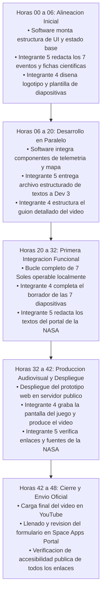

# MARS OUTPOST: HORIZONTE ROJO
## Entrenador de Misiones para Astronautas Junior (7 a 12 anos)
### Especificacion Maestra de Ejecucion · NASA International Space Apps Challenge 2026
#### Reto Oficial: Build a Junior Astronaut Mission Trainer

---

## 1. Identificacion y Alcance Conceptual de la Mision

### 1.1 Resumen Ejecutivo
MARS OUTPOST: Horizonte Rojo es un prototipo interactivo de simulacion web disenado especificamente para estudiantes de 7 a 12 anos. El usuario asume el rol de Comandante de Mision en un puesto avanzado cientifico ubicado en el Crater Jezero de Marte, en la region operativa del rover Perseverance. Durante una campana estructurada de siete Soles (dias solares marcianos), el estudiante debe gestionar recursos criticos interdependientes, enfrentar contingencias ambientales reales y comprender los principios fundamentales de la ingenieria de sistemas aeroespaciales mediante datos autenticos provistos por la NASA.

### 1.2 Declaracion de Proposito
El objetivo principal del proyecto es transformar conceptos abstractos de soporte vital, presupuestos energeticos y astrobiologia en un bucle interactivo de toma de decisiones. El simulador enfatiza que ninguna variable opera de forma aislada: cada decision de consumo genera un costo de oportunidad directo en la supervivencia y operatividad de la colonia.

### 1.3 Pilares Cientificos y Fuentes de Datos de la NASA
La simulacion incorpora datos, instrumentacion y literatura cientifica proveniente de misiones y programas activos de la NASA:

| Subsistema del Puesto | Instrumento / Programa de la NASA | Aplicacion Cientifica en el Simulador |
|---|---|---|
| Generacion de Energia | Mars Environmental Dynamics Analyzer (MEDA) - Perseverance | Modela la reduccion de eficiencia fotovoltaica por opacidad del polvo atmosferico (tau). |
| Produccion de Oxigeno | Mars Oxygen ISRU Experiment (MOXIE) - Perseverance | Modela la conversion de dioxido de carbono atmosferico (CO2) en oxigeno respirable (O2) mediante electrolisis. |
| Clima Espacial y Blindaje | Space Weather Database of Notifications (DONKI) y RAD (Curiosity) | Modela eventos de radiacion ionizante solar (CME) y la necesidad de refugio en regolito. |
| Soporte Vital y Reciclaje | Environmental Control and Life Support System (ECLSS) - ISS | Establece las tasas basales de consumo de agua, oxigeno y porcentaje de recuperacion en circuito cerrado. |
| Produccion de Alimentos | Veggie y Open Science Data Repository (OSDR) | Modela la relacion entre iluminacion LED, consumo de solucion hidroponica y tiempo diferido de cosecha. |

### 1.4 Innovaciones Clave del Modelo Pedagogico
1. **Trazabilidad y Honestidad Cientifica (Data Provenance):** Cada evento y medicion incluye un acceso directo titulado "Origen del Dato Cientifico", permitiendo al estudiante diferenciar entre observaciones reales de la NASA, modelos matematicos simplificados para el juego y elementos narrativos.
2. **Latencia de Comunicacion Interplanetaria:** Las transmisiones electromagneticas entre la Tierra y Marte experimentan un retraso unidireccional de 4 a 24 minutos. El simulador representa este desfase haciendo que las consultas a la Tierra tarden al menos un Sol en recibir respuesta, fomentando la autonomia y resolucion de problemas en el estudiante.
3. **Evaluacion Basada en Aprendizaje (Debriefing Formativo):** La conclusion de la campana no se limita a un resultado binario de victoria o derrota; evalua la consistencia de las decisiones tomadas y emite un Certificado Oficial de Cadete Junior que destaca las competencias adquiridas.

---

## 2. Definicion del Entregable de Software: Prototipo Funcional (PoC)

Es fundamental precisar que el alcance tecnico del software para este desafio consiste estrictamente en una **Prueba de Concepto (Proof of Concept - PoC) / Prototipo Funcional de Demostracion**. No constituye un producto de software en produccion ni requiere infraestructura industrial.

### 2.1 Criterios de Arquitectura del Prototipo
1. **Ejecucion Exclusiva de Lado Cliente (Client-Side SPA):** Toda la logica de simulacion, el balance de recursos y las transiciones de estado deben residir en el navegador web (React / JavaScript). Se descarta el uso de servidores backend complejos o bases de datos remotas que introduzcan puntos unicos de falla durante la evaluacion del jurado.
2. **Persistencia y Resiliencia sin Dependencias Externas:** Los conjuntos de datos de la NASA se integran de forma estatica en archivos JSON dentro de la aplicacion. Esto garantiza disponibilidad operativa total incluso si las APIs externas experimentan latencia o interrupciones de servicio.
3. **Acceso Inmediato sin Friccion:** El evaluador no debe requerir inicio de sesion, creacion de credenciales ni configuracion de entornos locales para interactuar con el simulador.
4. **Flujo de Evaluacion Optimizado (Happy Path):** La campana completa de siete Soles debe poder ejecutarse fluidamente en una sesion interactiva de 3 a 5 minutos, permitiendo evidenciar la totalidad de las mecanicas sin bloqueos de interfaz.

---

## 3. Asignacion Operativa: Equipo de Software (3 Integrantes)

El equipo de software tiene la responsabilidad de construir y desplegar el prototipo web funcional. Tienen total libertad para definir la estructura de codigo, estilos y herramientas complementarias, asegurando el cumplimiento de la siguiente distribucion funcional:

```text
[Equipo de Software: 3 Integrantes]
│
├── Desarrollador 1: Interfaz de Mando, Telemetria y Mapa Base (HUD)
├── Desarrollador 2: Motor Matematico de Simulacion y Estado Central
└── Desarrollador 3: Catalogo de Eventos, Modales Cientificos, Audio y Certificacion
```

### 3.1 Desarrollador 1: Interfaz de Mando, Telemetria y Mapa Base
* **Responsabilidad Principal:** Construccion visual, maquetacion responsiva y diseno de la experiencia de usuario orientada al publico de 7 a 12 anos.
* **Componentes y Funcionalidades Obligatorias:**
  1. **Consola Superior de Telemetria:** Visualizacion en tiempo real de los seis recursos mediante indicadores graficos claros con escalas de color (verde para estado optimo, amarillo para advertencia, rojo para nivel critico):
     * Energia disponible y reserva de acumuladores electricos (baterias).
     * Reserva de agua y estado del ciclo de recuperacion.
     * Nivel de oxigeno atmosferico de cabina y saturacion de filtros de dioxido de carbono.
     * Reserva de raciones alimentarias y estado de los cultivos.
     * Nivel de exposicion a radiacion ambiental y proteccion del puesto.
     * Indice de mantenimiento general y acumulacion de polvo en paneles.
  2. **Representacion Grafica del Puesto Avanzado:** Mapa interactivo o diagrama esquematico modular del crater Jezero que identifique claramente los cinco sectores funcionales:
     * Agrodome (Modulo Invernadero).
     * Power Core (Matriz Solar y Banco de Baterias).
     * Life Support (Modulo ECLSS y Unidad MOXIE).
     * Shield System (Domo de Regolito y Refugio de Tormenta).
     * Communications Station (Antena de Enlace Terrestre).
  3. **Panel de Control de Acciones:** Selector que permita al jugador ejecutar las acciones prioritarias de cada Sol (asignacion de energia, apertura o cierre de valvulas, ordenes de mantenimiento).
  4. **Navegacion Temporal:** Indicador permanente del Sol en curso (Sol 1 a Sol 7) y boton de confirmacion para avanzar al siguiente Sol.

### 3.2 Desarrollador 2: Motor Matematico de Simulacion y Estado Central
* **Responsabilidad Principal:** Desarrollo de la logica interna de calculo, control del estado global de la aplicacion y modelado de dependencias fisicas.
* **Componentes y Funcionalidades Obligatorias:**
  1. **Control Canónico del Estado (State Management):** Estructura centralizada que administre las variables cuantitativas de recursos, historial de decisiones acumuladas y estado biologico de la tripulacion.
  2. **Algoritmo de Transicion de Sol (Bucle de Simulacion):** Calculo determinista que resuelve al finalizar cada Sol:
     * Consumo basal de oxigeno y agua por astronauta.
     * Generacion fotovoltaica bruta ajustada por el factor de polvo atmosferico.
     * Balance neto entre demanda de energia de los modulos activos y almacenamiento disponible.
     * Progreso de maduracion de biomasa vegetal en el Agrodome.
  3. **Matriz de Interdependencias (Trade-offs):**
     * Si la energia resulta insuficiente para los sistemas termicos durante la noche marciana, la salud de la tripulacion decae proporcionalmente.
     * Si el suministro de agua al Agrodome se suspende, se detiene el ciclo de cultivo y cesa la contribucion suplementaria de oxigeno vegetal.
     * Si se activa la extraccion de oxigeno mediante MOXIE, se incrementa el consumo de energia en unidades predeterminadas.
  4. **Deteccion de Emergencias:** Rutinas de evaluacion que activan estados de advertencia cuando un recurso vital alcanza umbrales de riesgo, impidiendo estados negativos no controlados.

### 3.3 Desarrollador 3: Catalogo de Eventos, Modales Cientificos, Audio y Certificacion
* **Responsabilidad Principal:** Implementacion de la interactividad narrativa, ventanas de procedencia cientifica, retroalimentacion sonora y el sistema de evaluacion final.
* **Componentes y Funcionalidades Obligatorias:**
  1. **Modulo de Eventos de la Mision (Soles 1 al 7):** Ventana modal emergente al inicio de cada Sol que expone una contingencia operativa y requiere la seleccion de una de dos alternativas tecnicas con costos e impactos transparentes.
  2. **Componente de Procedencia Cientifica:** Boton interactivo denominado "Origen del Dato Cientifico", presente en cada evento, que despliega una ficha tecnica explicativa adaptada a lenguaje infantil, citando formalmente la fuente de la NASA asociada.
  3. **Sistema de Audio Espacial (Web Audio API):** Diseno de sonido procedural sintetizado de forma nativa sin archivos externos pesados (tonos de confirmacion de telemetria, senal acustica de advertencia y fanfarria de cierre de mision).
  4. **Modulo de Debriefing y Generacion de Certificado:**
     * Pantalla de diagnostico final que analiza la gestion de los seis recursos y la efectividad en la resolucion de incidentes.
     * Generacion dinamica del Certificado de Cadete Junior con el nombre del usuario, nivel alcanzado e insignias de merito obtenidas, con capacidad de impresion o guardado local.

### 3.4 Criterios de Aceptacion del Software (Definition of Done)
* El prototipo compila sin errores criticos y se ejecuta de forma consistente en navegadores web modernos (Chrome, Firefox, Safari, Edge).
* La interfaz mantiene adaptabilidad en resoluciones de escritorio y dispositivos moviles.
* Se encuentra disponible publicamente mediante un enlace directo de despliegue (Vercel, Netlify o GitHub Pages) accesible sin barreras de autenticacion.

---

## 4. Asignacion Operativa: Equipo de Plataforma, Video y Documentacion (2 Integrantes)

El equipo de documentacion y comunicacion tiene la responsabilidad critica de maximizar la evaluacion del jurado en las rubricas de impacto, narrativa, validez cientifica y presentacion visual.

```text
[Equipo de Plataforma y Documentacion: 2 Integrantes]
│
├── Integrante 4: Direccion Audiovisual, Video Oficial, Pitch Deck y Grafica
└── Integrante 5: Documentacion Tecnica, Formulario de Envio y Rigor Cientifico
```

### 4.1 Integrante 4: Direccion Audiovisual, Video Oficial, Pitch Deck y Grafica
* **Responsabilidad Principal:** Creacion de todos los materiales visuales, diapositivas y el video de presentacion obligatorio exigido por las bases de la NASA.
* **Entregables Concretos:**
  1. **Video de Demostracion Oficial (Requisito Estricto de la NASA):**
     * Duracion: Exactamente entre 60 y 90 segundos.
     * Formato de publicacion: Subido a YouTube o Vimeo con configuracion "Publico" u "Oculto (Unlisted)". Nunca privado.
     * Estructura del guion audiovisual:
       * Segundos 00 a 15: Planteamiento del problema (la educacion espacial convencional suele carecer de contexto de ingenieria o resulta excesivamente abstracta para ninos).
       * Segundos 15 a 55: Demostracion de captura de pantalla del prototipo en funcionamiento (recorrido por el HUD de Jezero, gestion de una tormenta de polvo con datos MEDA y consulta del origen cientifico).
       * Segundos 55 a 75: Muestra del efecto de latencia de radio con la Tierra y el despliegue del Certificado de Cadete Junior.
       * Segundos 75 a 90: Declaracion de impacto, agradecimientos a los datos abiertos de la NASA y cierre de mision.
  2. **Presentacion Ejecutiva (Slide Deck de 7 Laminas):** Disenada en Canva o Google Slides bajo lineamientos graficos sobrios con paleta marciana:
     * Lamina 1: Portada formal, denominacion del proyecto, reto abordado y lema.
     * Lamina 2: Identificacion de la problematica educativa y justificacion metodologica para el rango de 7 a 12 anos.
     * Lamina 3: Ingenieria energetica y condiciones ambientales en el crater Jezero (datos MEDA).
     * Lamina 4: Sistemas de soporte vital cerrado y produccion de oxigeno (ECLSS y MOXIE).
     * Lamina 5: Investigacion de biologia espacial y blindaje radiologico (Veggie, OSDR y DONKI).
     * Lamina 6: Recorrido grafico del prototipo web interactivo.
     * Lamina 7: Metricas de impacto pedagogico, integracion del equipo y enlace al proyecto en vivo.
  3. **Identidad Grafica y Activos Visuales:**
     * Diseno del logotipo formal del proyecto MARS OUTPOST.
     * Diseno de las cuatro insignias de merito para el certificado (Eficiencia Energetica, Soporte Vital Resiliente, Investigacion Biologica, Mando Operativo).
     * Seleccion de capturas de pantalla de alta resolucion para la galeria de la plataforma.

### 4.2 Integrante 5: Documentacion Tecnica, Formulario de Envio y Rigor Cientifico
* **Responsabilidad Principal:** Redaccion exhaustiva de las descripciones del proyecto en el portal oficial de NASA Space Apps y provision de contenidos cientificos al equipo de software.
* **Entregables Concretos:**
  1. **Textos Oficiales para la Plataforma de NASA Space Apps:**
     * **Project Title:** MARS OUTPOST: Horizonte Rojo - Junior Mission Trainer.
     * **Short Summary (Elevator Pitch):** Resumen de alto impacto de un solo parrafo.
     * **Detailed Project Description:** Redaccion que detalle el funcionamiento del simulador, el enfoque pedagogico y la relevancia de la experiencia interactiva.
     * **How We Developed This Project:** Descripcion de la metodologia de trabajo, decisiones tecnicas y diseno de la solucion.
  2. **Seccion Especializada "Space Agency Data":** Redaccion academica y catalogacion de los conjuntos de datos oficiales empleados, incorporando justificacion tecnica y enlaces directos a los portales de origen:
     * NASA Planetary Data System (PDS) - Atmospheres: Datos de MEDA sobre Perseverance.
     * NASA Space Weather Database of Notifications, Knowledge, and Information (DONKI).
     * NASA International Space Station ECLSS Research and Technology.
     * NASA Open Science Data Repository (OSDR).
     * Jet Propulsion Laboratory (JPL) - Perseverance MOXIE Technical Reports.
  3. **Contenidos de Texto para el Prototipo (Insumo para Desarrollador 3):**
     * Redaccion de los siete textos descriptivos de incidentes diarios.
     * Redaccion de las siete fichas de explicacion cientifica accesibles para ninos ("Origen del Dato Cientifico").
     * Mensajes de introduccion y guia emitidos por el asistente de mision NOVA.

---

## 5. Protocolo de Coordinacion y Cronograma de 48 Horas

Para garantizar que ambos grupos operen con sincronia y sin dependencias bloqueantes, se establece el siguiente esquema de entregas intermedias:



---

## 6. Lista de Verificacion Final de Entrega (Pre-Submission Checklist)

Antes de ejecutar el envio formal en la plataforma oficial de NASA Space Apps, el equipo en pleno debe certificar cada uno de los siguientes puntos:

1. [ ] **Enlace de la Demo Web:** El prototipo se encuentra desplegado publicamente y opera de forma correcta sin solicitar credenciales ni autenticacion.
2. [ ] **Verificacion de Acceso al Video:** El enlace de YouTube o Vimeo se ha verificado en una ventana de navegacion privada (modo incognito), confirmando reproduccion inmediata sin restricciones de privacidad.
3. [ ] **Duracion del Video:** La duracion total del video se encuentra estrictamente dentro del rango de 60 a 90 segundos.
4. [ ] **Repositorio de Codigo Publico:** El repositorio en GitHub se encuentra configurado como publico, con un archivo README.md que documenta la ejecucion local y los creditos del proyecto.
5. [ ] **Integridad de Citas de la NASA:** Cada fuente referenciada en la seccion "Space Agency Data" apunta a un dominio valido de la agencia o de sus centros de investigacion (nasa.gov, jpl.nasa.gov, osdr.nasa.gov).
6. [ ] **Prueba de Compatibilidad de Diapositivas:** El enlace de la presentacion (Google Slides / Canva / PDF en nube) cuenta con permisos publicos de visualizacion abierta.
